  

  

    <strong>Systems &amp; Backend Developer</strong> 
    Building concurrent systems, network services, and practical AI applications.
  

  

    
    
  

---

## About

I'm a software developer interested in **systems programming, backend engineering, networking, cybersecurity, and applied AI**. I like understanding how software behaves beneath the abstraction layer: how threads communicate, how packets move, how services handle concurrent work, and how applications use retrieved context and tools.

I learn by building, testing, profiling, and documenting projects. My current day-to-day stack includes **C++17, Go, and Python**, with JavaScript/TypeScript for application interfaces.

## Featured engineering projects

These projects best represent the areas I enjoy working in. Each entry links to implementation details or project documentation so the design can be inspected rather than relying on a list of claims.

### 1. Trade Engine — C++17

A multi-threaded limit-order matching engine prototype built around separate processing components for the client simulator, order gateway, matching engine, and asynchronous logger.

**Engineering focus**
- Single-producer/single-consumer ring buffers for communication between processing threads.
- CPU affinity and cache-aware data layout.
- Limit order book operations, order routing, and execution acknowledgements.
- Pre-allocated memory pools and asynchronous logging.

**Inspect the implementation:** [Project README](https://github.com/subhamchauhan0/Trade_Engine#readme) · [SPSC queue](https://github.com/subhamchauhan0/Trade_Engine/blob/main/header/lock_free_queue.h) · [Limit order book](https://github.com/subhamchauhan0/Trade_Engine/blob/main/header/lob_struct.h) · [Thread affinity](https://github.com/subhamchauhan0/Trade_Engine/blob/main/header/Thread.h) · [Examples and tests](https://github.com/subhamchauhan0/Trade_Engine/tree/main/ExamplesAndTesting)

**Performance evidence:** [Benchmark log](https://github.com/subhamchauhan0/Trade_Engine/blob/main/Benchmark.md) contains percentile measurements from 100,000- and 1,000,000-order runs. The log does not currently record enough hardware, compiler, and workload details to make portable performance claims, so treat these figures as project-local observations rather than guaranteed latency.

### 2. Load Balancer — Go

A networking project with two operating modes: Layer 4 packet handling and a Layer 7 HTTP reverse proxy.

**Engineering focus**
- Layer 4 packet capture and packet handling with `gopacket` / `libpcap`, IP/TCP header updates, and raw socket transmission.
- Layer 7 HTTP reverse proxying with Go's `net/http`.
- Round Robin and Least Connections backend selection.
- Periodic TCP health checks for backend availability.

**Inspect the implementation:** [Project README and setup](https://github.com/subhamchauhan0/LoadBalancer#readme) · [Layer 4 and Layer 7 proxy code](https://github.com/subhamchauhan0/LoadBalancer/tree/main/internal/proxy) · [Routing algorithms](https://github.com/subhamchauhan0/LoadBalancer/tree/main/internal/routingAlgo) · [CLI commands](https://github.com/subhamchauhan0/LoadBalancer/tree/main/cmd)

Layer 4 mode depends on Linux networking capabilities and elevated packet-capture / raw-socket permissions. Follow the repository instructions and test it in an isolated environment.

## Additional projects

### MatchMaker

A full-stack matchmaking project with a Go backend and a separate frontend. The backend is organised into controller, middleware, model, router, database, and WebSocket-related modules.

**Explore:** [Repository](https://github.com/subhamchauhan0/MatchMaker) · [Backend](https://github.com/subhamchauhan0/MatchMaker/tree/main/Backend) · [WebSocket module](https://github.com/subhamchauhan0/MatchMaker/tree/main/Backend/webSockets) · [Frontend](https://github.com/subhamchauhan0/MatchMaker/tree/main/Frontend)

### Chatbot — RAG and tool experiments

An application project with a Python backend and a separate Vite-based frontend. The backend includes distinct modules for the chatbot, retrieval-augmented generation, and tools.

**Explore:** [Repository](https://github.com/subhamchauhan0/chatbot) · [RAG implementation](https://github.com/subhamchauhan0/chatbot/blob/main/backend/src/rag.py) · [Tool module](https://github.com/subhamchauhan0/chatbot/blob/main/backend/src/tools.py) · [Frontend](https://github.com/subhamchauhan0/chatbot/tree/main/Frontend)

## Technical toolkit

| Area | Technologies and concepts |
| :--- | :--- |
| **Languages** | C++17, Go, Python, JavaScript, TypeScript, SQL |
| **Systems** | Multithreading, POSIX threads, CPU affinity, SPSC queues, memory pools, cache-aware data structures |
| **Networking** | TCP/IP, raw sockets, packet capture, `libpcap`, HTTP reverse proxies, WebSockets |
| **Backend** | REST APIs, authentication, SQL databases, migrations, health checks |
| **AI applications** | Retrieval-Augmented Generation (RAG), LangChain, LangGraph, tool integration, Model Context Protocol (MCP) |
| **Tools and environment** | Linux, Git, CMake, Make, Docker, GDB |

## How I approach engineering

- **Understand the system:** map the data flow, interfaces, failure modes, and constraints before adding complexity.
- **Make trade-offs explicit:** consider latency, throughput, memory use, concurrency, and operational requirements.
- **Validate behaviour:** use focused tests, reproducible examples, and benchmarks where appropriate.
- **Document the evidence:** link design notes, code, setup instructions, and measured results—and state the limits of those results.

## Find me

- [GitHub repositories and contribution activity](https://github.com/subhamchauhan0)
- [LeetCode](https://leetcode.com/u/Subham_chauhan/)

   

  **STRUGGLE. ENDURE. OVERCOME.**

  Built with curiosity, tested with care, improved one iteration at a time.

